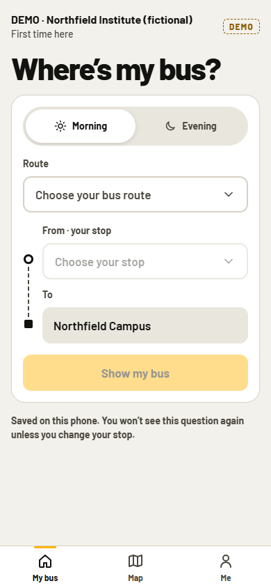
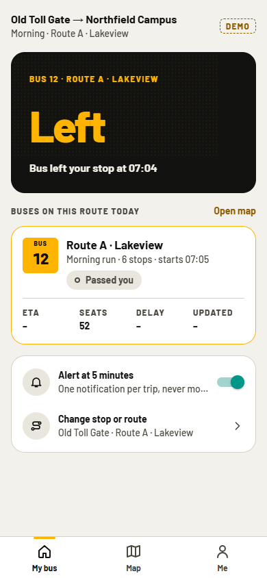
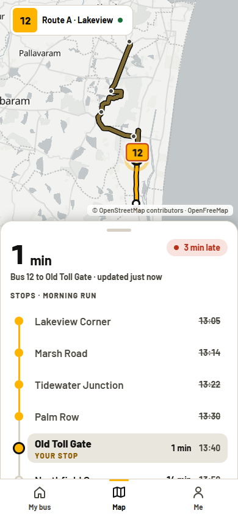
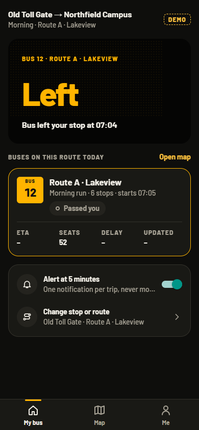
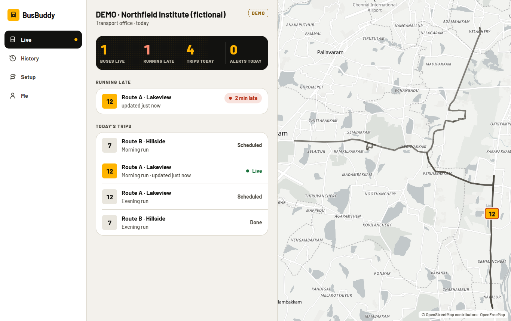
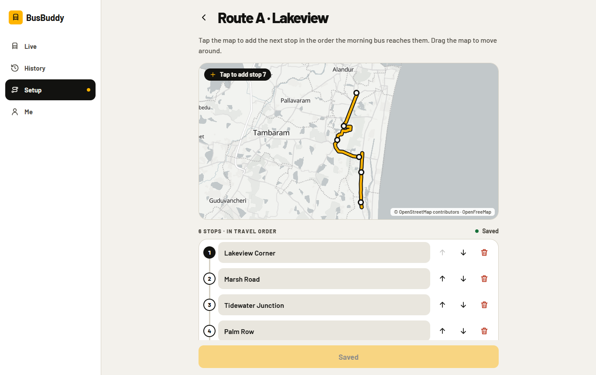
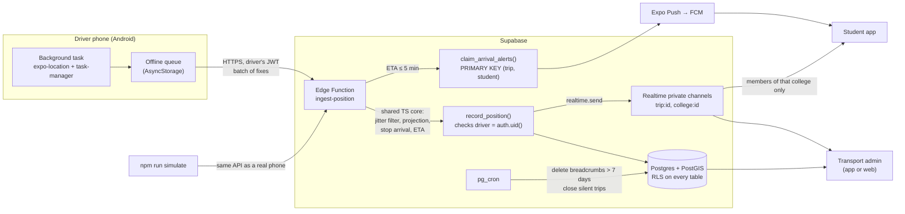

# BusBuddy

Live tracking for college buses: students see where their bus is and when it reaches their stop; the transport office sees the whole fleet.

**Live demo:** TODO: add the GitHub Pages link after the first deploy (see [Deploy → Web demo](#web-demo-github-pages)).
**Android app:** [install page for the standalone APK](https://expo.dev/accounts/devkeerthip/projects/busbuddy/builds/0945c595-a8c8-4f72-96d6-d08c71fd9d08) (EAS preview build; open it on the phone and tap Install). Push alerts need the Firebase step in [Push notifications](#push-notifications-firebase--fcm-v1).

## Who is this for and what problem does it solve?

Students wait at stops not knowing whether the college bus has already left, is two minutes away or is running 20 minutes late. They phone friends on the bus or the driver, who should be driving. Transport offices have no idea where their fleet is until someone calls.

BusBuddy answers **“Where’s my bus?”** in one glance:

- **Students and staff** open the app and see a big ETA for their stop, the delay against the timetable, and when it was last updated. One push alert arrives when the bus is about 5 minutes away.
- **Drivers** press one big button. Location is shared in the background until the last stop, then stops on its own.
- **Transport offices** set up routes, stops, buses, timetables and drivers from the app (or the web version), see every live bus on one map, which trips are late, and a 7-day history.

Any college can set itself up. Members join with an invite code, and colleges are fully isolated from each other by database policies.

## Screenshots

| Ask once | The answer | Live map and stop timeline |
| --- | --- | --- |
|  |  |  |

| Dark mode | Transport office (web, desktop) | Route editor |
| --- | --- | --- |
|  |  |  |

Taken from the Expo web build with the clearly labelled **DEMO** college while `npm run simulate` drove Bus 12 towards the student’s stop (the “Arriving” state, one minute out).
TODO: add Android screenshots of the driver screen (Start trip, Sharing location) from a real phone.

## Features

- **“Where’s my bus?” home**: choose route, your stop and Morning / Evening once (remembered on the phone and in your account). After that the app opens straight on the answer.
- **ETA board**: minutes to your stop, bus number, on time / late / early, “last updated 40 s ago”. After 30 s without a signal the digits dim and get a “~”.
- **States that mean something**: not started (with departure time), on the way, at your stop, left your stop (with time), finished, cancelled.
- **Live map** (MapLibre + free OpenStreetMap tiles): the bus glides along the road between GPS points, the driven part is muted, and a draggable sheet with spring physics shows the stop timeline. Your stop pulses when the bus is about 5 minutes away.
- **Driver mode**: today’s trip in one sentence and one huge Start button. Background location runs with an Android foreground-service notification. Arrival at each stop is detected automatically. The trip ends at the last stop or with a deliberate press-and-hold.
- **Arrival alert**: “Bus 12 is about 5 min away”, sent once per student per trip, guaranteed by a database constraint.
- **Transport admin**: setup checklist; routes drawn by tapping stops on a map (or snapped to the road a bus actually drove); buses; weekly trips with per-stop times (auto-filled from distance); invite codes with rotation; roles; fleet map; late trips; history; usage counts.
- **Multi-college** with roles (student/staff, driver, transport admin, platform admin) and Row Level Security everywhere.
- **Simulator**: drives a demo route through the real API, with GPS noise, bad fixes and a signal dead zone.
- Light (default, for sunlight) and dark themes, large tap targets, screen-reader labels, reduced-motion support.

## Tech stack

| Layer | Choice |
| --- | --- |
| App | Expo SDK 58 (React Native 0.88), Expo Router, TypeScript (strict), Reanimated 4, Gesture Handler 3 |
| Maps | `@maplibre/maplibre-react-native` (Android/iOS), `maplibre-gl` (web), OpenFreeMap tiles (OpenStreetMap data) |
| Location / push | `expo-location` + `expo-task-manager` (foreground service), `expo-notifications` + Expo Push Service (FCM V1) |
| Backend | Supabase: Postgres 17 + PostGIS, Auth, Realtime (private broadcast channels), Edge Functions (Deno), pg_cron |
| Validation | zod in the app and in the Edge Function, plus database `CHECK` and foreign-key constraints |
| Tests | Jest (pure tracking logic) and Jest against the real database inside rolled-back transactions (RLS) |

## Architecture



The tracking logic lives once, in `supabase/functions/_shared/core/` (plain TypeScript, no dependencies). The Edge Function runs it on Deno, the app imports it for the gliding bus and travel-order helpers, and Jest tests it directly.

## Design decisions

1. **One Edge Function in front of every GPS fix, with all writes made as the driver.**
   The function runs the jitter filter, route projection, stop detection and ETA, then calls `record_position()` *with the driver’s own JWT*. The database therefore still decides who may publish (RLS and `driver_id = auth.uid()`).
   *Alternatives:* drivers insert positions directly (no server-side filtering, and ETA logic in every client); or all logic in PL/pgSQL (hard to unit-test).
   *Trade-off:* one function call per batch counts against the free tier’s 500k invocations/month, which is plenty for a college fleet (see Limitations).

2. **Projection with a time-bounded search window.**
   Each fix is projected onto the route polyline, but only within the distance a bus could physically have covered since the last fix (≥ 200 m, or 33 m/s × elapsed). Indian roads often loop back past themselves (U-turns at median gaps); the demo routes do exactly that. A global nearest-point search jumped the bus 1.5 km ahead in testing. Progress never goes backwards, so sideways wobble can’t fake movement.

3. **Hysteresis for arrivals, and no speed updates while dwelling.**
   A bus arrives after 2 consecutive fixes within 40 m and departs only beyond 80 m. A stop driven past without stopping is marked “passed” after 150 m. While the bus waits at a stop its smoothed speed is frozen: dwell is already added per stop, and counting zero-speed samples once made a 5 km ETA read 43 minutes (found by the simulator, now a regression test).

4. **ETA = remaining distance ÷ smoothed speed + dwell, blended with history.**
   Speed is an EWMA (α 0.3) of progress *along the route*, clamped to 2–20 m/s. Once a template has ≥ 3 completed trips, each segment blends towards its historical average time (weight up to 0.7). The blend fades out within 500 m of the stop, where live data is better.

5. **De-duplicated alerts by construction.**
   `notification_log` has `PRIMARY KEY (trip_id, user_id, kind)`; `claim_arrival_alerts()` does `INSERT … ON CONFLICT DO NOTHING RETURNING` and only returned rows are pushed. Retries, duplicate fixes or two function instances cannot send twice.

Smaller ones: evening trips are the same route in reverse travel order instead of a second route; the driver phone records a fix every 5 s but uploads every 10 s while moving and every 20 s while standing (a fixed distance filter made a bus waiting at a stop look offline); light theme is default for sunlight; MapLibre + OpenFreeMap needs no billing account.

## Run locally

Prerequisites: Node 20+ (tested on 24), a Supabase project, and for the Android app an [Expo account](https://expo.dev).

```bash
npm install                 # also copies the web map worker into public/
cp .env.example .env        # fill in every value (each one is explained in the file)
npm run db:migrate          # creates tables, RLS, functions and cron jobs
npm run db:seed             # DEMO college + demo accounts (written to .demo-accounts.local)
npm run web                 # web version at http://localhost:8081
```

One-time Supabase dashboard settings:
- **Authentication → Providers → Email:** for a pilot, turn off “Confirm email”, or add custom SMTP. Supabase’s built-in sender allows only a few emails per hour.
- **Realtime → Settings:** leave private channels enabled. The app only uses private channels guarded by RLS.

Then:
- Sign up in the app with an email from `ADMIN_EMAILS` and run `npm run db:admins` to become platform admin.
- `npm run functions:deploy` deploys the Edge Function. It needs `npx supabase login` once.

### Try the whole thing with the simulator

```bash
npm run simulate -- --route A --period morning            # full route
npm run simulate -- --route A --period morning --from 3   # start at the 4th stop (quicker demo)
```

Sign in on the web as the demo student from `.demo-accounts.local` and pick **Route A → Old Toll Gate** to watch the bus come in. By default the simulator shifts the DEMO timetable so the bus is on time; `--keep-schedule` keeps the seeded times. To run the Edge Function locally instead of deployed, use `npm run functions:serve` (needs `supabase/functions/.env` with `SUPABASE_URL`, `SUPABASE_PUBLISHABLE_KEYS` and `SUPABASE_SECRET_KEYS`). Then run the simulator with `INGEST_URL=http://127.0.0.1:8000`.

### Tests

```bash
npm test          # tracking core, ETA, alerts, invite codes, formatting (offline)
npm run test:db   # RLS, driver publishing, invite joining, alert de-dup: real DB, every test rolled back
npm run lint && npm run typecheck
```

## Android build (EAS)

Background location, MapLibre and push need a development build (Expo Go can’t run them).

1. Install and sign in: `npm i -g eas-cli` then `eas login`.
2. Link the project: `eas init`. Copy the printed project ID into `.env` as `EAS_PROJECT_ID`.
3. Give EAS the same public variables (cloud builds don’t read your `.env`):
   ```bash
   eas env:set --name EXPO_PUBLIC_SUPABASE_URL --value https://<ref>.supabase.co --environment development --environment preview --visibility plaintext
   eas env:set --name EXPO_PUBLIC_SUPABASE_PUBLISHABLE_KEY --value sb_publishable_... --environment development --environment preview --visibility plaintext
   eas env:set --name EAS_PROJECT_ID --value <project-id> --environment development --environment preview --visibility plaintext
   ```
4. Set up push (below), then build:
   ```bash
   eas build -p android --profile development   # dev client: pairs with `npx expo start --dev-client`
   eas build -p android --profile preview       # standalone APK for drivers and students
   ```
5. EAS prints an install link and QR code. Open it on the phone, allow “install unknown apps” for the browser, and install. Paste the link at the top of this README.

### Checking the Android app on a phone

Use two phones (or one phone plus the web app for the student side), both signed in to DEMO accounts from `.demo-accounts.local`.

1. **Install**: open the install page above on the phone → Install → allow “install unknown apps” for the browser.
2. **Student**: sign in as the demo student → pick Morning, Route A, your stop → **Show my bus**. You should see the bus list, then the map tab with stops.
3. **Driver**: sign in as Demo Driver A on the phone → tap **Start trip** → allow location **“Allow all the time”** and notifications. A “Sharing location” notification must stay in the status bar.
4. **Live movement**: walk or drive a few hundred metres. Within ~10 s the student’s bus marker moves, the ETA updates and “last updated” stays under 30 s. (At a desk, skip the driver phone and run `npm run simulate -- --route A --period morning`; it drives a demo bus along the real route as a demo driver.)
5. **Background**: lock the driver phone for 2 minutes. The student view should keep updating; if it freezes, apply the battery steps below.
6. **End**: use **Hold to end trip**. The student sees the trip finished.
7. **Push** (after the Firebase step): on the student phone turn on “Alert at 5 minutes”; it should fire once when the bus is about 5 minutes from the stop.

If something fails, `npx supabase functions logs ingest-position` (or Supabase dashboard → Edge Functions → Logs) shows each upload and why it was rejected.

### Push notifications (Firebase / FCM V1)

Android delivers Expo push notifications through Firebase Cloud Messaging, so each deployment needs its own Firebase project:

1. In the [Firebase console](https://console.firebase.google.com) create a project. You can turn Analytics off.
2. **Add app → Android.** The package name must equal `android.package` in `app.config.ts` (default `io.github.devkeerthicode.busbuddy`, or your `ANDROID_PACKAGE`). Download **google-services.json** into the project root (it is gitignored) and give it to EAS, which only uploads files git tracks:
   ```bash
   eas env:create --name GOOGLE_SERVICES_JSON --type file --value ./google-services.json --environment development --environment preview --environment production --visibility secret
   ```
3. **Project settings → Service accounts → Generate new private key.** Keep this JSON private (never commit it).
4. Upload it to Expo: `eas credentials` → **Android** → **production** → **Google Service Account** → **Manage your Google Service Account Key for Push Notifications (FCM V1)** → **Set up a Google Service Account Key for Push Notifications (FCM V1)** → **Upload a new service account key**.
5. Rebuild the app. Students who turn on “Alert at 5 minutes” register their phone automatically.
6. Optional: if you enable “enhanced push security” in Expo, set `EXPO_ACCESS_TOKEN` as an Edge Function secret (`npx supabase secrets set EXPO_ACCESS_TOKEN=...`).

### Drivers: stop Android from killing location sharing

Android brands aggressively stop background apps to save battery. If they do, the bus freezes on students’ maps. On each driver’s phone, once:

- **Every phone:** when asked for location, choose **Allow all the time**. Keep the “Sharing Bus … location” notification; it is what keeps tracking alive. Settings → Apps → BusBuddy → Battery → **Unrestricted** (or “Don’t optimize”).
- **Xiaomi / Redmi / POCO (MIUI / HyperOS):** Settings → Apps → Manage apps → BusBuddy → **Autostart: on**, Battery saver → **No restrictions**. In Recents, pull the BusBuddy card down to **lock** it.
- **Samsung (One UI):** Settings → Battery → Background usage limits → remove BusBuddy from “Sleeping apps” / “Deep sleeping apps” and add it to **Never sleeping apps**.
- **OnePlus / Oppo / Realme (ColorOS / OxygenOS):** Settings → Battery → BusBuddy → **Allow background activity** and **Allow auto launch**. Turn off “Optimise battery use” for it.
- **Vivo / iQOO (Funtouch / OriginOS):** Settings → Battery → Background power consumption management → BusBuddy → **Allow**. In i Manager, allow **Auto-start**.
- **Motorola / Nokia / Pixel (near-stock):** Settings → Apps → BusBuddy → App battery usage → **Unrestricted**.

[dontkillmyapp.com](https://dontkillmyapp.com) keeps current instructions per brand.

## Deploy

Everything runs on free tiers.

| Piece | Where | How |
| --- | --- | --- |
| Database, Auth, Realtime, cron | Supabase (free) | `npm run db:migrate` (idempotent; tracks applied files in `private.schema_migrations`) |
| Edge Function | Supabase | `npx supabase login` once, then `npm run functions:deploy` |
| Android app | EAS Build (free tier) | see [Android build](#android-build-eas) |
| Web version | GitHub Pages | see below |

Required variables: `EXPO_PUBLIC_SUPABASE_URL`, `EXPO_PUBLIC_SUPABASE_PUBLISHABLE_KEY` (app and web), `SUPABASE_SECRET_KEY`, `DATABASE_URL`, `ADMIN_EMAILS` (scripts only), `EAS_PROJECT_ID` (builds). Edge Functions receive `SUPABASE_URL` and the key sets from Supabase automatically.

### Web demo (GitHub Pages)

The workflow in `.github/workflows/pages.yml` exports the Expo web build on every push to `main` and publishes it.

1. Repo → Settings → Pages → Source: **GitHub Actions**.
2. Repo → Settings → Secrets and variables → Actions → add `EXPO_PUBLIC_SUPABASE_URL` and `EXPO_PUBLIC_SUPABASE_PUBLISHABLE_KEY`.
3. Push. The site appears at `https://<your-user>.github.io/busbuddy/`. Visitors sign up and join the DEMO college with its student code (shown in the app under Setup → People for the demo admin). TODO: put the link at the top.

## Limitations and what breaks at scale

- **Edge Function invocations.** A moving bus uploads every 10 s. Two 45-minute trips a day come to about 540 calls, or roughly 12–16k per bus per month. The free tier’s 500k covers about 30 buses; beyond that, send bigger batches less often or move ingestion to a small always-on server.
- **Realtime fan-out.** Each position is broadcast to a trip channel and a college channel. Supabase’s free tier caps concurrent Realtime connections (200) and messages. A college with 1,000 students opening the map at 8 am would need the Pro plan or an aggregated per-route channel.
- **Background location is best-effort on Android.** Some OEMs kill foreground services despite settings. Trips with no fix for 30 minutes are closed by cron, and students see “last updated N min ago” rather than a wrong position.
- **Straight-line routes until a real trip is recorded.** Routes drawn by tapping stops are straight segments, so ETAs on winding roads start pessimistic. One “Use this trip’s path” click fixes it, but the first week is less accurate.
- **ETA ignores traffic patterns by time of day.** History is averaged per segment over 60 days, not per hour. Monsoon days and exam-day traffic will surprise it.
- **One college per account.** It keeps every screen unambiguous, but a person who works with two colleges needs two accounts.
- **Built-in email limits.** Supabase’s default SMTP sends only a few emails per hour, so email confirmation for a whole class needs custom SMTP (or confirmation turned off for a pilot).
- **Session storage** uses AsyncStorage (unencrypted app-private storage), so the same storage works for the background task and on web. A rooted phone could read the session token.
- **iOS** is untested: the code is iOS-ready, but builds need an Apple developer account.

## What I learned

- GPS projection is only easy on paper. Real roads loop back on themselves, and a nearest-point search happily teleports the bus to the other carriageway. Bounding the search by physically reachable distance fixed it.
- Where to put logic matters for testing. Keeping the tracking core as dependency-free TypeScript let the same code run on Deno, in the app and in Jest. The database owns only what it is best at: permissions, uniqueness and fan-out.
- RLS needs its own tests. Two real bugs showed up only when testing against the live database: a rate limit that rolled back its own counter, and Realtime partitions that didn’t exist yet.
- A simulator is worth building on day one. It exposed the inflated-ETA-while-dwelling bug that no unit test I had written would have caught.

## What I’d improve next

- Per-hour segment history, and showing an ETA range (“6–9 min”) instead of a single number when confidence is low.
- A “bus is full” button for drivers and a crowding indicator for students.
- A small always-on ingest service (or Supabase Queues) to batch writes, so the free tier stretches to large fleets.

## Repo

- About line: `Live college bus tracking: students see their bus and ETA, drivers press one button, transport offices see the whole fleet. Expo + Supabase.`
- Topics: `react-native`, `expo`, `supabase`, `postgis`, `realtime-tracking`
