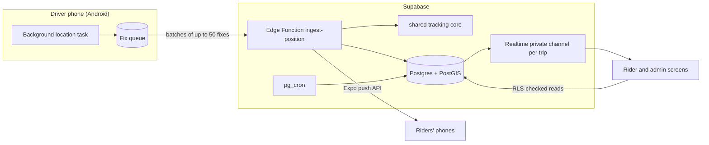

# Architecture

- **Clients**: one Expo Router codebase for Android and web.
- **Server logic**: Postgres functions for anything that must be atomic or permission-checked; one Edge Function for the hot path (positions).
- **Shared core**: the same TypeScript tracking code runs in the Edge Function (Deno), the app and Jest.
- **No custom server**: everything runs on Supabase's free tier.
