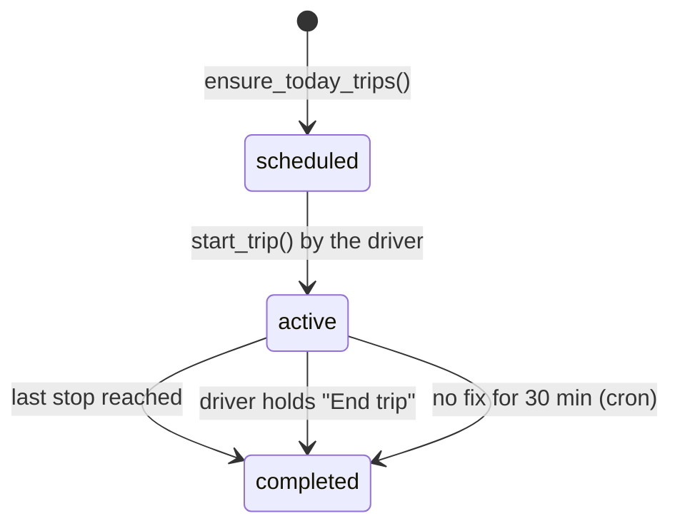

# Trip lifecycle

Turning a template off (Setup → Trips → "Running") means no trip is created for it on later days. The `cancelled` status exists in the schema and every screen shows it, but no function sets it yet; it is reserved for cancelling a single day's run.

1. **scheduled**: created for today from each running template whose weekday matches, in the college's time zone. Riders see "Leaves at 07:05".
2. **active**: the driver tapped **Start trip**. Positions are accepted only now, and only from that driver.
3. **completed**: the bus arrived at the last stop, the driver ended it, or `close_stale_trips` found no fix for 30 minutes.

Ending a trip clears the live fields riders see. Stop events and breadcrumbs stay for history.
